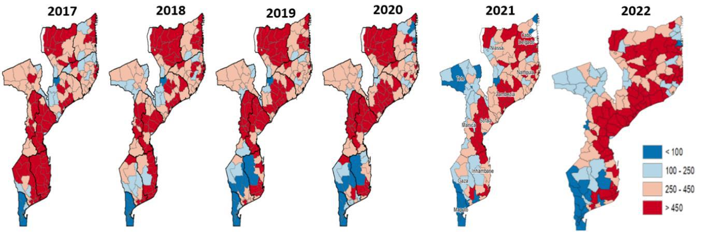
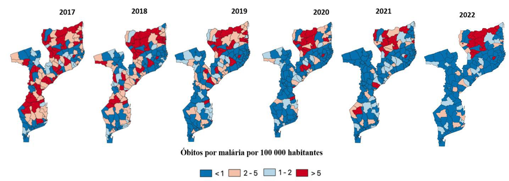
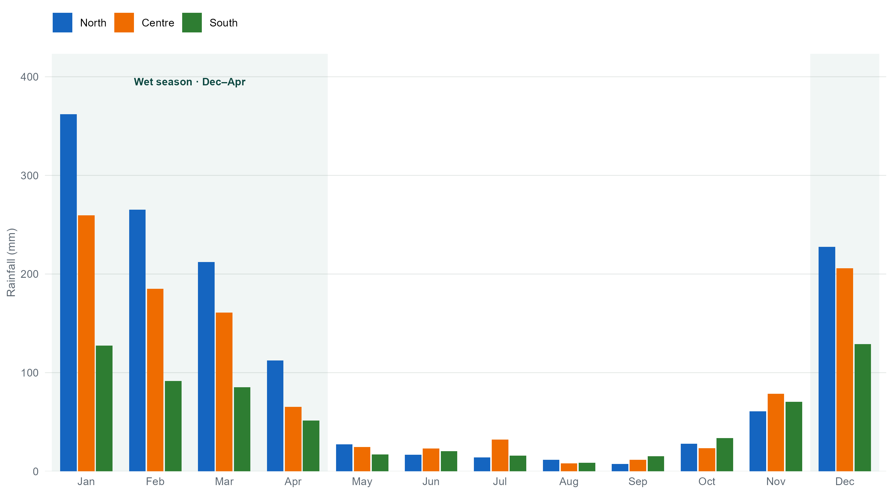
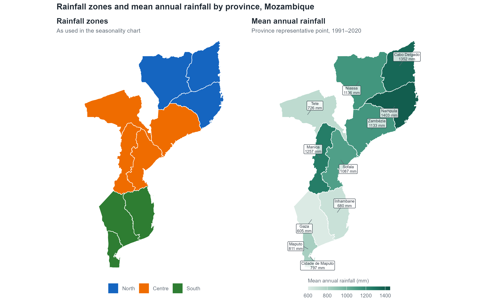

```{r}
#| include: false
with_root <- function(expr) { old <- setwd(".."); on.exit(setwd(old)); expr }
with_root({
  source("R/text_utils.R")
  source("R/fig_admin_map.R")
  source("R/fig_timeline.R")
  source("R/fig_health_system.R")
  source("R/fig_facility_map.R")
  source("R/fig_facility_rank.R")
  source("R/sec10_vector_profile.R")
  source("R/references.R")
})
```

## 1. Introduction

Mozambique sits in southeastern Africa within the WHO African Region, 
among the five highest-burden malaria countries globally, with roughly 34.6 million people at risk (WHO, 2024). 
What sets Mozambique apart is that malaria control here is not a targeted, 
geographically bounded effort: the entire population is classified as at high risk, 
with no low-risk or malaria-free zones anywhere in the country. This universal exposure, 
combined with perennial transmission and a north-east to south-west burden gradient, 
makes malaria control central to the country's health system,
with malaria cases equivalent to about a quarter of all outpatient consultations in 2022 (SIS-MA, via PMI, 2024).

---


## 2. Summary Statistics

**Table 1:** Statistical summary of Mozambique.


```{r}
#| echo: false
#| message: false
suppressPackageStartupMessages({ library(dplyr); library(openxlsx); library(kableExtra) })

epi_data <- read.xlsx("../submissions/mozambique/epi_table_mozambique.xlsx", sheet = "Data")

esc <- function(x) {
  x <- gsub("&", "&amp;", x, fixed = TRUE)
  x <- gsub("<", "&lt;", x, fixed = TRUE)
  gsub(">", "&gt;", x, fixed = TRUE)
}

# Whole numbers get thousands separators; decimals get one decimal place;
# words (for example a city) are left as they are.
fmt <- function(v) {
  n <- suppressWarnings(as.numeric(v))
  out <- as.character(v)
  whole <- !is.na(n) & abs(n - round(n)) < 1e-9
  dec <- !is.na(n) & !whole
  out[whole] <- formatC(n[whole], format = "f", digits = 0, big.mark = ",")
  out[dec] <- formatC(round(n[dec], 1), format = "f", digits = 1, big.mark = ",")
  out
}

tbl <- epi_data %>%
  filter(Types == "KCI", Country == "Mozambique")

tbl <- tbl %>%
  transmute(
    Indicator = esc(Metric),
    Value = fmt(Value),
    Unit = ifelse(Unit == "text", "", esc(Unit)),
    Year = as.character(Year),
    Source = ifelse(is.na(Link) | Link == "", esc(Source),
                    paste0("<a href='", Link, "'>", esc(Source), "</a>")),
    `Retrieved via` = esc(Retrieved_via)
  ) %>%
  mutate(across(everything(), ~ ifelse(is.na(.x), "", .x)))
tbl <- tbl %>% select(-`Retrieved via`)
kbl(tbl, escape = FALSE) %>%
  kable_styling(bootstrap_options = c("striped", "hover", "condensed"),
                full_width = TRUE, font_size = 13) %>%
  row_spec(0, bold = TRUE, background = "#1F3A5F", color = "white") %>%
  column_spec(1, bold = TRUE)
```


---


## 3. Administrative Boundaries

Mozambique lies between latitudes 10°S to 27°S and longitudes 30°E to 41°E, occupying 799,380 km² along the south-east African coast. 
It is divided into eleven provinces, 154 statutory districts, 457 postos administrativos and 1,712 localidades, alongside a separate elected structure of 65 municipalities (OCHA, 2025). 
OCHA's Common Operational Dataset renders 161 admin-2 units because it treats Maputo City's seven distritos municipais as districts; 
use 161 for any geospatial work, since the DHIS2 organisation units, the facility registry and the SNT layers are all built on it. 
Health districts follow the administrative districts, which is what makes district-level stratification operationally tractable. The maps on this page use the Malaria Atlas Project boundary set, which also has 161 district-level units.

```{r}
#| include: false
txt_admin_map <- with_root(fig_admin_map_text("mozambique"))
```

```{r}
#| label: fig-admin-map
#| echo: false
#| message: false
#| warning: false
#| fig-cap: !expr txt_admin_map$caption
#| fig-width: 9
#| fig-height: 6.5
with_root(fig_admin_map("mozambique"))
```

**Source:** `r italicise_species(txt_admin_map$source)`


---


## 4. Malaria Situation

Mozambique contributes to more than 3.6% of estimated global malaria cases annually, 
one of five countries (alongside Nigeria, DRC, Ethiopia, and Uganda) that together account for over half of all global cases, 
and one of 11 high-burden African countries that account for roughly two-thirds of global cases and deaths (WHO, 2025). 
WHO estimates about 10.2 million malaria cases and 17,946 deaths in Mozambique in 2024 (WHO, 2025). 
The national programme's routine reports for the same year are higher for cases, about 11.5 million, 
and far lower for deaths, 358 in-hospital deaths, because routine data count only the cases and deaths seen at health facilities (WHO, 2025). 
Efforts to reduce transmission have resulted in some improvements: cases fell 12% and deaths 1% between 2023 and 2024, 
but cyclones and extremist-group activity remain the greatest threats to this progress, as the resulting displacement, 
deaths, and breaks in service provision often leave societies vulnerable (WHO, 2024; WHO, 2025).

---


## 5. History of Malaria

Mozambique's modern programme dates to the re-establishment of the NMCP in 1982, 
but the decisive shift came in the mid-2000s, when failing monotherapies gave way to 
artemisinin-based combination therapy and intermittent preventive treatment in 
pregnancy began nationally (MISAU, 2006). 
Over the following decade the programme built out universal coverage: vector control and 
parasitological diagnosis, mass insecticide-treated net campaigns, indoor residual spraying in selected high-burden districts and 
rapid diagnostic tests extended to community level under successive strategic plans in 
2012, 2017 and 2023, with nationwide DHIS2 reporting from 2015 giving district-level 
routine data for the first time; since 2020 the emphasis has moved from 
uniform national coverage to subnational tailoring, with intervention packages 
assigned by stratum (MISAU, 2023). 
The current mix combines pyrethroid chlorfenapyr nets deployed against widespread pyrethroid resistance, 
targeted IRS, IPTp, seasonal malaria chemoprevention in Nampula (introduced in 2022; the 2024–25 campaign was cancelled in January 2025 amid post-election unrest), universal testing with RDTs followed by artemether-lumefantrine and 
the R21 vaccine introduced in Zambézia in 2024 though cyclones, COVID-19 and post election unrest have repeatedly interrupted delivery 
and the 2023-2030 plan remains costed well beyond secured financing (Gavi, the Vaccine Alliance, 2024; 
Malaria Consortium, 2025; GiveWell, 2025; MISAU, 2023; OCHA, 2026).

```{r}
#| include: false
txt_timeline <- with_root(fig_timeline_text("mozambique"))
```

```{r}
#| label: fig-timeline
#| echo: false
#| message: false
#| warning: false
#| fig-cap: !expr txt_timeline$caption
#| fig-width: 12
#| fig-height: !expr with_root(fig_timeline_height("mozambique"))
with_root(fig_timeline("mozambique"))
```

**Source:** `r italicise_species(txt_timeline$source)`

```{r}
#| echo: false
#| results: asis
cat("<details><summary>Timeline sources</summary>\n\n")
print(knitr::kable(with_root(timeline_sources("mozambique"))))
cat("\n\n</details>\n")
```


---


## 6. Malaria Indicator Summary

### 6a. DHIS2-derived indicators (incidence)

**Table 2:** Malaria indicators from the national DHIS2 instance (SIS-MA), Mozambique, 2022.


```{r}
#| echo: false
#| message: false
suppressPackageStartupMessages({ library(dplyr); library(openxlsx); library(kableExtra) })

epi_data <- read.xlsx("../submissions/mozambique/epi_table_mozambique.xlsx", sheet = "Data")
disp <- read.csv("../config/display_dhis2.csv", stringsAsFactors = FALSE, na.strings = "")

esc <- function(x) {
  x <- gsub("&", "&amp;", x, fixed = TRUE)
  x <- gsub("<", "&lt;", x, fixed = TRUE)
  gsub(">", "&gt;", x, fixed = TRUE)
}
fmt <- function(v) {
  n <- suppressWarnings(as.numeric(v))
  out <- as.character(v)
  whole <- !is.na(n) & abs(n - round(n)) < 1e-9
  dec <- !is.na(n) & !whole
  out[whole] <- formatC(n[whole], format = "f", digits = 0, big.mark = ",")
  out[dec] <- formatC(round(n[dec], 1), format = "f", digits = 1, big.mark = ",")
  out
}
key <- function(x) tolower(trimws(x))

d <- epi_data %>%
  filter(Types == "DHIS2", Country == "Mozambique", as.character(Year) == "2022")

# Group, label and order come from the display list. Anything not on the
# list goes to the end under 'Other'; rows marked 'hidden' are left out.
pos <- match(key(d$Metric), key(disp$Metric))
d$Group <- ifelse(is.na(pos), "Other", disp$Group[pos])
d$Label <- ifelse(is.na(pos) | is.na(disp$Label[pos]), d$Metric, disp$Label[pos])
d$Order <- ifelse(is.na(pos), 1e6 + seq_len(nrow(d)), pos)
d <- d[d$Group != "hidden", ]
group_levels <- unique(c(disp$Group[disp$Group != "hidden"], "Other"))
d <- d[order(match(d$Group, group_levels), d$Order), ]

# One shared source? Then say it once under the table.
base <- trimws(sub(",?\\s*Table\\s+\\d+\\s*$", "", d$Source))
ref  <- ifelse(grepl("Table\\s+\\d+\\s*$", d$Source), sub("^.*(Table\\s+\\d+)\\s*$", "\\1", d$Source), "")
lnk  <- ifelse(is.na(d$Link), "", d$Link)
one_source <- length(unique(base)) == 1 && length(unique(lnk)) == 1 &&
  length(unique(d$Retrieved_via)) == 1

tbl <- data.frame(Indicator = esc(d$Label), Value = fmt(d$Value),
                  Unit = ifelse(d$Unit == "text", "", esc(d$Unit)),
                  stringsAsFactors = FALSE)
if (one_source) {
  if (any(ref != "")) tbl$`Table in source` <- ref
} else {
  tbl$Source <- ifelse(lnk == "", esc(d$Source), paste0("<a href='", lnk, "'>", esc(d$Source), "</a>"))
  tbl$`Retrieved via` <- esc(d$Retrieved_via)
}
tbl[is.na(tbl)] <- ""

idx <- table(factor(d$Group, levels = unique(d$Group)))
k <- kbl(tbl, escape = FALSE) %>%
  kable_styling(bootstrap_options = c("hover", "condensed"), full_width = TRUE, font_size = 13) %>%
  row_spec(0, bold = TRUE, background = "#1F3A5F", color = "white") %>%
  pack_rows(index = setNames(as.integer(idx), names(idx)),
            label_row_css = "background-color: #EEF2F7; color: #1F3A5F; font-weight: 600;")

note <- ""
if (one_source) {
  src <- if (lnk[1] == "") esc(base[1]) else paste0("<a href='", lnk[1], "'>", esc(base[1]), "</a>")
  note <- paste0("<p class='det-source'><strong>Source:</strong> ", src, " (2022 data). Retrieved via: ",
                 esc(d$Retrieved_via[1]), ".",
                 if (any(ref != "")) " The column 'Table in source' gives the table number in the source report, not a table on this page." else "",
                 "</p>")
}
knitr::asis_output(paste0(as.character(k), note))
```


### 6b. Survey-derived indicators (prevalence / mortality)

Nationally representative household surveys provide the population-based measures that routine facility data cannot: 
parasite prevalence in children, net ownership and use, chemoprevention in pregnancy, and care-seeking for childhood fever. 
The table below draws on successive survey rounds (DHS, AIS and MIS), allowing each indicator to be read as a trajectory rather than a single point, 
with gaps shown as a dash where an indicator was not measured in that round.

**Table 3:** Malaria survey indicators.


```{r}
#| echo: false
#| message: false
source("../R/statcompiler.R")
survey_table("../submissions/mozambique/STATcompilerExport2026913_17924.xlsx", "Mozambique", "../config/display_survey.csv", n_rounds = 5)
```


---


## 7. Health System

Public health services reach an estimated 60% of the population, while the private sector is largely limited to major cities (PMI, 2024).
There has been progressive investment in health infrastructure, particularly rural healthcare.
The health sector is coordinated nationally by the Ministry of Health (MISAU), 
with implementation devolved to Provincial Health Directorates (DPS) and 
District Health Services (SDSMAS). There are efforts to decentralise resources and 
decision-making authority from central to provincial level.
The healthcare system is hierarchically structured into four levels:

- Levels I and II: primary care, peripheral facilities (health posts and rural clinics).
- Levels III and IV: secondary and tertiary care with specialised services.

```{r}
#| include: false
txt_health_system <- with_root(fig_health_system_text("mozambique"))
```

```{r}
#| label: fig-health-system
#| echo: false
#| message: false
#| warning: false
#| fig-cap: !expr txt_health_system$caption
#| fig-width: 12.4
#| fig-height: !expr with_root(fig_health_system_height("mozambique"))
with_root(fig_health_system("mozambique"))
```

**Source:** `r italicise_species(txt_health_system$source)`


### Community Health Workers (CHWs)

CHWs, locally known as Agentes Polivalentes Elementares (APEs) play a critical role in healthcare delivery, 
especially in remote areas. There are 17,648 deployed out of 18,000 planned and 5,595 of these are 
involved in diagnosing and treating uncomplicated malaria as well as promoting preventive measures, 
and referring severe cases (End Malaria Global Community Health Dashboard). APEs are keystone for malaria control in rural and remote areas.

Mozambique transitioned from paper based reporting that was aggregated at district, provincial and national level to a DHIS2 based system in 2015. 
While the initial approach was reliable and consistent, the quality of data did not meet malaria control management needs. 
Currently a full information M&E system based on the DHIS2 platform collects malaria data. 
This includes outpatient attendance, testing, and confirmed cases, with disaggregation by age and gender. 
Facilities with electronic systems fill data directly to the system and paper based records are entered into the system by district health teams.
Efforts are underway to strengthen real-time data availability for decision-making.

Routine indicators in DHIS2 include outpatient visits for suspected malaria and laboratory-confirmed cases by rapid diagnostic test (RDT), 
with age-disaggregated data on positive cases. Periodic household surveys such as IMASIDA (the 2015 Immunization, Malaria and HIV Indicators Survey) 
add population-based data on treatment-seeking behaviour, bed-net coverage and use, and coverage of interventions.

### Geographic location of health facilities

```{r}
#| echo: false
#| results: asis
#| message: false
#| warning: false
cat(with_root(facility_text_map("mozambique")))
```

```{r}
#| include: false
txt_facility_map <- with_root(fig_facility_map_text("mozambique"))
```

```{r}
#| label: fig-facility-map
#| echo: false
#| message: false
#| warning: false
#| fig-cap: !expr txt_facility_map$caption
#| fig-width: 9
#| fig-height: 7
with_root(fig_facility_map("mozambique"))
```

**Source:** `r italicise_species(txt_facility_map$source)`


```{r}
#| echo: false
#| results: asis
#| message: false
#| warning: false
cat(with_root(facility_text_rank("mozambique")))
```

```{r}
#| include: false
txt_facility_rank <- with_root(fig_facility_rank_text("mozambique"))
```

```{r}
#| label: fig-facility-rank
#| echo: false
#| message: false
#| warning: false
#| fig-cap: !expr txt_facility_rank$caption
#| fig-width: 9
#| fig-height: !expr with_root(fig_facility_rank_height("mozambique"))
with_root(fig_facility_rank("mozambique"))
```

**Source:** `r italicise_species(txt_facility_rank$source)`


## 8. Stratification Maps / SNT

Mozambique uses maps to inform decision making and planning. 
A structured approach to optimizing malaria interventions in Mozambique involves using complementary analytical methods. 
It begins with spatial analysis of malaria burden to prioritize high-impact areas. 
Empirical data analysis and mathematical models help refine intervention targeting by evaluating past interventions and predicting optimal strategies. 
Cost-effectiveness analysis ensures interventions maximize case reductions within a fixed budget over five years. 
Finally, operational feasibility adjustments account for logistical and geographic constraints, ensuring interventions are practical and effectively implemented. 
This multi-faceted approach enhances the impact and efficiency of malaria control efforts. In addition to prevalence and incidence maps, 
risk maps and vulnerability to epidemics are mapped at district level. This aids with tailoring of interventions.

{#fig-r1}


::: {.det-source}
**Source:** National Malaria Strategic Plan (NMSP) of Mozambique: 2023 – 2030 https://mesamalaria.org/resource-hub/national-malaria-strategic-plan-nmsp-of-mozambique-2023-2030/
:::


{#fig-r2}


::: {.det-source}
**Source:** National Malaria Strategic Plan (NMSP) of Mozambique: 2023 – 2030 https://mesamalaria.org/resource-hub/national-malaria-strategic-plan-nmsp-of-mozambique-2023-2030/
:::


{#fig-r3}


::: {.det-source}
**Source:** National Malaria Strategic Plan (NMSP) of Mozambique: 2023 – 2030 https://mesamalaria.org/resource-hub/national-malaria-strategic-plan-nmsp-of-mozambique-2023-2030/
:::


Parasite prevalence by RDT in children aged 6–59 months follows a steep north–south gradient, 
exceeding 33% across the northern and central provinces and peaking at 54.7% in Nampula, 
falling to 10–20% in Tete, Inhambane and Manica, and approaching zero in the far south (5.7% 
in Gaza, 0.3% in Maputo Province and 0.0% in Cidade de Maputo; 2022–23 DHS, IDS).
  
---


## 9. Environment and Seasonality

Transmission is sustained year-round by warm temperatures: mean monthly temperature stays above 18 ℃ 
in every province except the Manica highlands, so the thermal threshold for sporogonic development of 
*Plasmodium falciparum* is rarely a constraint, while low-lying coastal and riverine terrain and 
abundant surface water provide continuous *Anopheles* breeding habitat 
(MISAU, 2023; NASA Langley Research Center, 2025). Intensity follows a north-south ecological gradient, 
from the wet, densely populated northern provinces to the drier south, 
with mean annual rainfall falling from 1,403 mm in Nampula to 605 mm in Gaza and mean annual temperature 
ranging from 25.4 ℃ in Zambezia down to 21.2 ℃ on the Manica plateau, 
the one area cool enough in June-August (16.3 ℃ in July) to slow the parasite's development materially 
(NASA Langley Research Center, 2025). Because temperature is permissive almost everywhere, 
rainfall sets the timing: a single wet season from December to April concentrates precipitation (362 mm in 
January in the north against 128 mm in the south) and, with cases lagging rainfall by roughly six to ten weeks (Harp et al., 2021), 
transmission peaks from December to April (PMI, 2024), earlier and sharper in the north and centre than in the south, 
where transmission is lower and more seasonal (MISAU, 2023).

{#fig-r4}


::: {.det-source}
**Source:** NASA POWER, parameter PRECTOTCORR (precipitation corrected, MERRA-2), 30-year climatology January 1991 – December 2020, retrieved at each province's representative interior point via the POWER Climatology API. https://power.larc.nasa.gov/
:::


{#fig-r5}


::: {.det-source}
**Source:** NASA POWER, parameter PRECTOTCORR (precipitation corrected, MERRA-2), 30-year climatology January 1991 – December 2020, retrieved at each province's representative interior point via the POWER Climatology API. https://power.larc.nasa.gov/
:::


---


## 10. Vector Profile

Malaria transmission in Mozambique is sustained by three primary vectors *Anopheles funestus*, 
*An. arabiensis* and *An. gambiae* sensu stricto with the saltwater breeding *An. merus* contributing along the southern and central coast; 
species-distribution models place *An. funestus* and *An. arabiensis* across virtually the whole country, 
while *An. gambiae* s.s. is concentrated in the wetter north and centre and *An. merus* is restricted to the 
coastal strip (Sinka et al., 2010; Wiebe et al., 2017). Recent entomological work documents multiple insecticide resistance in *An. funestus* (Kiuru et al., 2025); 
the monitoring record is summarised in Table 5 and described below. 
P450-mediated pyrethroid resistance, shown by the restoration of deltamethrin mortality with piperonyl butoxide (PBO), is the operational rationale for the shift to dual-active-ingredient and PBO nets and for rotating IRS products away from pyrethroids.

```{r}
#| include: false
txt_vectors <- with_root(fig_vectors_text("mozambique"))
```

```{r}
#| label: fig-vectors
#| echo: false
#| message: false
#| warning: false
#| fig-cap: !expr txt_vectors$caption
#| fig-width: 11
#| fig-height: !expr with_root(fig_vectors_height("mozambique"))
with_root(fig_vectors("mozambique"))
```

**Source:** `r italicise_species(txt_vectors$source)`


### Vector and parasite species

Malaria in Mozambique is primarily caused by *Plasmodium falciparum*, the most virulent malaria parasite. 
The vector species are described above, and Table 4 summarises the parasite and vector facts.

**Table 4:** Vectors and Parasite species summary.

```{r}
#| echo: false
#| message: false
suppressPackageStartupMessages(library(kableExtra))
kableExtra::kbl(with_root(tbl_vector_summary("mozambique")), format = "html", escape = FALSE, align = "l") %>%
  kable_styling(bootstrap_options = c("striped", "hover", "condensed"), full_width = TRUE, font_size = 13) %>%
  row_spec(0, bold = TRUE, background = "#1F3A5F", color = "white") %>%
  column_spec(1, bold = TRUE)
```

Insecticide resistance in Mozambique has followed a clear trajectory over twenty-five years of monitoring. 
In collections from 2000–02, *Anopheles funestus* s.s. was already pyrethroid-resistant in the far south but 
fully susceptible to DDT and to the organophosphate malathion everywhere tested (Casimiro et al., 2006). 
By 2006–10 the same pyrethroid resistance had reached central Mozambique, appearing in *An. funestus* in Mocuba, Zambézia, 
while DDT and deltamethrin still killed 100% of mosquitoes (Abílio et al., 2011). In collections from 2021–22 in Mopeia, 
also Zambézia, *An. funestus* s.l. was resistant to all four classes tested: 14% mortality to deltamethrin, 
37% to bendiocarb, 67% to pirimiphos-methyl and 79% to DDT with piperonyl butoxide restoring deltamethrin 
mortality from 8% (deltamethrin alone in the synergist assay, a separate batch of wild-caught females) to 80% (Kiuru et al., 2025). Two features of that last result matter operationally: the organophosphate reading, 
because pirimiphos-methyl is a mainstay IRS product, and the PBO restoration, 
because it identifies cytochrome P450 monooxygenases as the mechanism and is the direct evidence base for PBO and dual-active-ingredient nets.


**Table 5:** Insecticide susceptibility of malaria vectors, Mozambique, 2000–2022.

```{r}
#| echo: false
#| message: false
suppressPackageStartupMessages(library(kableExtra))
kableExtra::kbl(with_root(tbl_susceptibility("mozambique")), format = "html", escape = FALSE, align = "l") %>%
  kable_styling(bootstrap_options = c("striped", "hover", "condensed"), full_width = TRUE, font_size = 13) %>%
  row_spec(0, bold = TRUE, background = "#1F3A5F", color = "white")
```

---


## 11. References

```{r}
#| echo: false
#| results: asis
cat(with_root(render_references("mozambique", c("boundaries", "facilities", "vectors"))), sep = "\n")
```

---


## Abbreviations

| Abbreviation | Meaning |
|---|---|
| ACT | Artemisinin-based Combination Therapy |
| AI | Active Ingredient |
| AIS | AIDS Indicator Survey |
| An. | Anopheles |
| APE | Agente Polivalente Elementar |
| API | Application Programming Interface |
| AQ | Amodiaquine |
| CC BY 4.0 | Creative Commons Attribution 4.0 |
| CC0 | Creative Commons Zero (public-domain dedication) |
| CHW | Community Health Worker |
| COD-AB | Common Operational Dataset &#8211; Administrative Boundaries |
| COVID-19 | Coronavirus Disease 2019 |
| DDT | Dichlorodiphenyltrichloroethane |
| DHIS2 | District Health Information Software 2 |
| DHS | Demographic and Health Survey |
| DPS | Direc&#231;&#227;o Provincial de Sa&#250;de |
| DRC | Democratic Republic of the Congo |
| FY | Fiscal Year |
| Gavi | Gavi, the Vaccine Alliance (formerly the Global Alliance for Vaccines and Immunisation) |
| HDX | Humanitarian Data Exchange |
| HIV | Human Immunodeficiency Virus |
| ICF | ICF International |
| IDS | Inqu&#233;rito Demogr&#225;fico e de Sa&#250;de |
| IMASIDA | Inqu&#233;rito de Indicadores de Imuniza&#231;&#227;o, Mal&#225;ria e HIV/SIDA |
| INE | Instituto Nacional de Estat&#237;stica |
| IPTp | Intermittent Preventive Treatment in pregnancy |
| IRS | Indoor Residual Spraying |
| ITN | Insecticide-Treated Net |
| M&amp;E | Monitoring and Evaluation |
| MERRA-2 | Modern-Era Retrospective analysis for Research and Applications, Version 2 |
| MIS | Malaria Indicator Survey |
| MISAU | Minist&#233;rio da Sa&#250;de |
| MOP | Malaria Operational Plan |
| NASA | National Aeronautics and Space Administration |
| NMCP | National Malaria Control Programme |
| NMSP | National Malaria Strategic Plan |
| OCHA | United Nations Office for the Coordination of Humanitarian Affairs |
| P450 | Cytochrome P450 monooxygenases |
| PBO | Piperonyl Butoxide |
| PHC | Primary Health Care |
| PIDOM | Pulveriza&#231;&#227;o Intradomicili&#225;ria (indoor residual spraying) |
| PMC | Perennial Malaria Chemoprevention |
| PMI | U.S. President's Malaria Initiative |
| POWER | Prediction Of Worldwide Energy Resources |
| PRECTOTCORR | Precipitation, total, corrected |
| RDT | Rapid Diagnostic Test |
| RHIS | Routine Health Information System |
| s.l. | sensu lato |
| s.s. | sensu stricto |
| SDSMAS | Servi&#231;os Distritais de Sa&#250;de, Mulher e Ac&#231;&#227;o Social |
| SIS-MA | Sistema de Informa&#231;&#227;o para Sa&#250;de &#8211; Monitoria e Avalia&#231;&#227;o |
| SMC | Seasonal Malaria Chemoprevention |
| SNT | Subnational Tailoring |
| SP | Sulfadoxine-Pyrimethamine |
| T2M | Temperature at 2 metres |
| UNICEF | United Nations Children's Fund |
| WHO | World Health Organization |
| WHO AFRO | WHO Regional Office for Africa |

